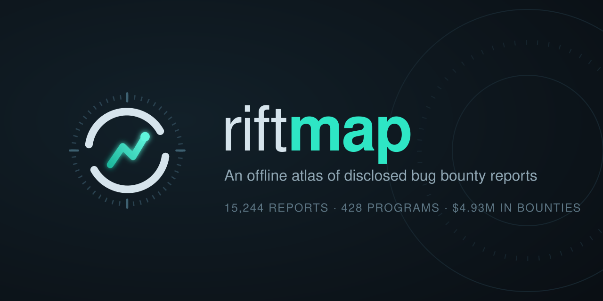
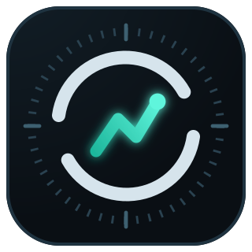
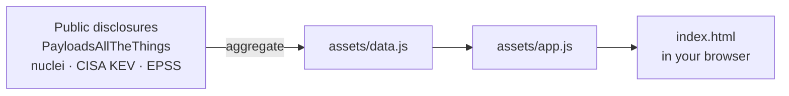

<!-- Brand assets live in docs/: logo.svg (mark), banner.svg (this header),
     social-preview.png (GitHub social card), logo-512.png (avatar). -->
<p align="center">
  
</p>

<h1 align="center">
   Riftmap
</h1>

<p align="center">
  <b>An offline atlas of publicly disclosed bug bounty reports.</b><br>
  Explore 15,000+ disclosures by vulnerability class, weakness and program. No server, no internet, no install.
</p>

<p align="center">
  
  
  
  <br>
  
  
  
  
</p>

<p align="center">
  <a href="#-quick-start">Quick start</a> ·
  <a href="#-features">Features</a> ·
  <a href="#-whats-inside">What's inside</a> ·
  <a href="#-data-sources">Data sources</a> ·
  <a href="#-responsible-use">Responsible use</a>
</p>

<!-- SCREENSHOT (optional): add an image at docs/screenshot.png and uncomment the block below.
<p align="center">
  
</p>
-->

---

## ✨ Why Riftmap?

Disclosed bug bounty reports are one of the best ways to learn how real systems break, but they're scattered across thousands of pages. **Riftmap** pulls the aggregate picture into one fast, keyboard-friendly atlas that runs straight from a folder on your disk.

> [!TIP]
> Hit a wall while testing? Jump to the **Evasions**, **Payloads** and **CVEs** views to see how others got past the same defences.

## 🚀 Quick start

```bash
git clone <your-repo-url> riftmap
cd riftmap
```

Then **open `index.html` in your browser**. That's it: no build step, no server, no network.

<details>
<summary>Prefer serving it locally?</summary>

```bash
# any static server works, for example:
python -m http.server 8000
# then visit http://localhost:8000
```
</details>

## 🧭 Features

| View | What you get |
| :--- | :--- |
| 🗺️ **Atlas** | Interactive dial of all 18 vulnerability classes, sized by report volume and bounty paid |
| 📚 **Index** | Browse by class → weakness → program, with counts, bounties and severity mix |
| 🏢 **Programs** | All 428 programs A–Z, each with its class breakdown and payout history |
| 📈 **Insights** | Trends over time, class-to-class links and where the money goes |
| 🛡️ **Evasions** | 18 groups of bypass techniques: SSO, MFA, WAFs, CSP, SSRF guards, upload checks and more |
| 💉 **Payloads** | 64 payload topics, indexed for quick lookup |
| 🧨 **CVEs** | Recent CVE tracker with CVSS, EPSS, known-exploited and ransomware flags |
| 🔎 **Search** | Press <kbd>/</kbd> anywhere to find a class, weakness, program, CVE or payload |

### By the numbers

<table>
  <tr>
    <td align="center"><h3>15,244</h3>disclosed reports</td>
    <td align="center"><h3>428</h3>programs</td>
    <td align="center"><h3>18</h3>vulnerability classes</td>
    <td align="center"><h3>215</h3>weaknesses</td>
    <td align="center"><h3>$4.93M</h3>bounties paid</td>
  </tr>
</table>

<details>
<summary><b>All 18 vulnerability classes</b></summary>

| Class | Reports | Class | Reports |
| :--- | ---: | :--- | ---: |
| Cross-site Scripting | 2,587 | Denial of Service | 636 |
| Information Disclosure | 1,996 | Business Logic | 488 |
| Access Control | 1,494 | Cryptography | 405 |
| Authentication | 1,365 | Injection and Smuggling | 389 |
| Misconfiguration | 1,263 | Insecure Direct Object Reference | 373 |
| Memory Corruption | 917 | Open Redirect | 357 |
| Code Execution | 831 | SQL Injection | 332 |
| Other weaknesses | 656 | Server-Side Request Forgery | 329 |
| Cross-Site Request Forgery | 530 | Path Traversal | 296 |

</details>

## 📦 What's inside

```text
riftmap/
├── index.html            # app shell
├── assets/
│   ├── app.js            # routing, views, charts, search (vanilla JS)
│   ├── data.js           # pre-aggregated dataset (window.HB_DATA)
│   ├── styles.css        # dark theme and layout
│   └── fonts/            # bundled Recursive font, no CDN
├── docs/
│   └── logo.svg          # ← replace with your logo
└── versions/
    └── v1-base/          # archived first version
```



### Customising

- **Rename the site:** change `BRAND` at the top of `assets/app.js`.
- **Refresh the numbers:** regenerate `assets/data.js` from newer source data.
- **Swap the logo:** replace `docs/logo.svg` (README) and the inline SVG in `index.html` (site header and favicon).

## 🗂️ Data sources

| Source | Used for |
| :--- | :--- |
| Public HackerOne disclosures (open `hackerone-reports` dataset) | Report counts, classes, weaknesses, programs, bounties |
| [PayloadsAllTheThings](https://github.com/swisskyrepo/PayloadsAllTheThings) (MIT) | Payload topics |
| [nuclei-templates](https://github.com/projectdiscovery/nuclei-templates) | CVE detection coverage |
| [CISA KEV](https://www.cisa.gov/known-exploited-vulnerabilities-catalog) | Known-exploited status |
| [EPSS](https://www.first.org/epss/) | Exploitation likelihood |

Numbers are a **2026-11-21 snapshot** of aggregate statistics. Full report write-ups are not bundled; each report remains the work of its author and the program that disclosed it.

## ⚖️ Responsible use

Every report counted here describes a vulnerability that was **fixed and then disclosed** by the program concerned. Use this material to learn, and **only test systems you have permission to test**, within each program's scope.

Riftmap is an independent project with no affiliation to HackerOne or to any program listed.

## 🤝 Contributing

Issues and pull requests are welcome, whether that's a new view, a better chart, or fresher data.

1. Fork the repo and create a branch: `git checkout -b feature/my-idea`
2. Make your change and open `index.html` to check it
3. Open a pull request describing what changed

## 📄 License

<!-- Choose a license (e.g. MIT) and add a LICENSE file, then update this line. -->
License added.

<p align="center"><sub>Built for hunters, defenders and the curious · works offline</sub></p>
